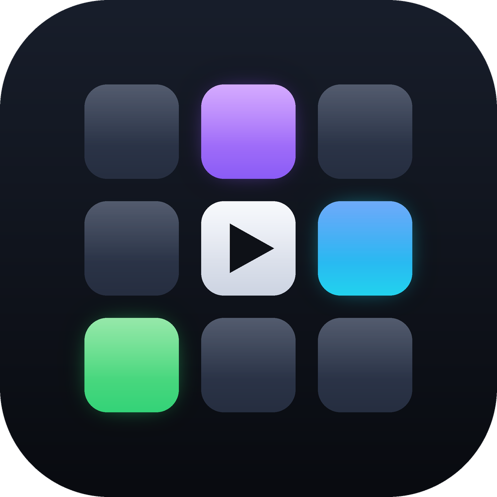

Stream Deck do Celular

Transforme o celular num painel de controle do seu PC com Windows: troque cenas do OBS, abra Steam/Epic/jogos, alterne janelas, rode "Modos" (ex.: Modo Stream), veja o chat da live e até controle o PC remotamente. Roda como um site servido pelo seu próprio PC, e tem um app Android opcional.

Recursos
OBS: trocar cena, iniciar/encerrar stream e gravação, mutar áudio, replay, câmera virtual (via WebSocket do OBS)
Steam e Epic Games: lista e abre seus jogos instalados; pasta Jogos com atalhos da sua área de trabalho
Janelas abertas: alternar, minimizar, fechar ou encerrar (segure o botão)
Modos: sequências de passos com perguntas Sim/Não (ex.: Modo Stream abre o OBS e pergunta se abre o DroidCam). Editáveis pelo celular
Tudo editável: renomear, trocar logo, ocultar, criar abas, pastas, atalhos, painéis de programa
Chat da live (YouTube e Twitch) ao lado dos botões
Controle remoto: tela do PC + mouse e teclado pelo celular
App Android com tela de "PC desconectado" que conecta sozinho quando o servidor liga
Sem dependências: só Python 3 (biblioteca padrão)
Como usar
Instale o Python 3 no Windows (marque "Add to PATH").
Dê dois cliques em iniciar.bat. Ele mostra o endereço e o PIN.
No celular (mesmo Wi-Fi), abra o endereço (ex.: http://192.168.0.15:8765) e digite o PIN.

Guia completo (OBS, firewall, editor, modos, chat, controle remoto): LEIAME.txt.

App Android (opcional)

A pasta android_app é um projeto do Android Studio (WebView + tela de desconectado + busca do PC na rede). Abra a pasta no Android Studio, selecione um JDK 17 ou 21 em Settings > Build Tools > Gradle > Gradle JDK e rode no celular.

Acesso de fora de casa

Use uma VPN privada como o Tailscale e acesse http://100.x.x.x:8765. Não abra a porta no roteador.

Segurança
Este painel controla o seu PC. Tudo exige o PIN (5 erros bloqueiam por 1 minuto).
O tráfego é HTTP simples: use só em rede de confiança ou dentro de uma VPN.
O celular só envia "qual botão foi tocado"; os comandos ficam no seu config.json.
Nunca publique o config.json (tem PIN e chave). Ele já está no .gitignore.
Estrutura
server.py            servidor (HTTP, OBS WebSocket, ações do Windows)
web/                 painel (HTML/JS, sem build)
screen_helper.ps1    captura de tela do controle remoto
icon_extract.ps1     extrai ícones reais dos programas
android_app/         app Android
iniciar.bat          inicia o servidor
Aviso

O chat do YouTube usa um método não oficial e pode parar de funcionar se o YouTube mudar algo. Parte do código (captura de tela, mouse/teclado e janelas) usa APIs do Windows e foi escrita sem poder rodar no Windows durante o desenvolvimento; relate problemas nas Issues.

Créditos e licenças de terceiros
Ícones de interface: Lucide (licença ISC)
Logos de marcas: Simple Icons (CC0). As marcas pertencem aos seus donos; uso apenas para identificar os programas
OBS Studio, Steam, Epic Games, Discord, DroidCam, YouTube e Twitch são marcas de seus respectivos donos. Este projeto não é afiliado a eles
Licença

MIT
